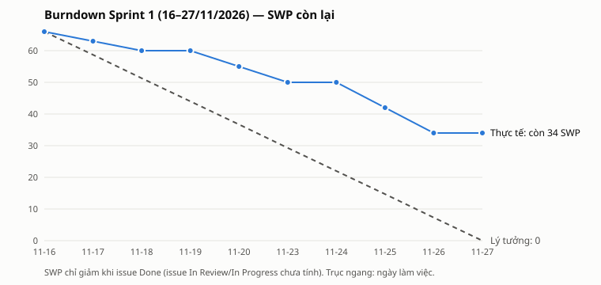

# Báo cáo tiến độ — Sprint 1 (giả lập)

- **Iteration trên Project:** `Sprint 1` (trường Iteration của [GitHub Project](https://github.com/users/haiht-1795/projects/1))
- **Khoảng thời gian giả lập:** 2026-11-16 → 2026-11-27 (10 ngày làm việc). Ngày báo cáo: 2026-11-27.
- **Gửi:** Yuki Cold Logistics — bộ phận phụ trách dự án. Dữ liệu trạng thái là giả lập (PREMISE A-03).

## Tóm tắt cho khách

Sprint 1 dựng xong nền tảng kỹ thuật và màn quản lý phiên bản quy tắc giờ lái 2024 (SCR-017). Hoàn thành **32/71 SWP (45%)**; đội đã ghi **249 giờ thực tế**. Việc đã Done tốn 179 giờ so với 167 giờ ước (hệ số 1,07, ước lượng khá sát). Hai việc lớn phải chuyển sang Sprint 2: module quy tắc hạn dùng/phân bổ và mô hình timeline tài xế. Kế hoạch Sprint 2–3 đã được lập lại theo năng lực từng người (mục 3).
Việc cần khách hỗ trợ gấp: **trả lời OQ-28, OQ-29, OQ-30, OQ-58 và cử người xác minh pháp lý cho 改善基準告示**. Đây là đường găng của mốc demo kiểm giờ lái (cuối Sprint 3, 2026-12-25).

## 1. Trạng thái

| Trạng thái | Số issue | Tổng SWP | Giờ ước | Giờ thực tế | Còn lại (ước lại) | Ghi chú |
|---|---:|---:|---:|---:|---:|---|
| Done | 6 | 32 | 128 | 130 | 0 | #15, #16, #22, #25, #31, #102 |
| In Review | 2 | 10 | 40 | 38 | 6 | #17, #32 |
| In Progress | 2 | 26 | 104 | 75 | 45 | #58, #106 |
| Blocked | 1 | 3 | 15 | 6 | 9 | #105 |
| **Cam kết** | **11** | **71** | **287** | **249** | **60** | |

Ghi chú:
- #17 (OIDC + MFA) xong code nhưng chờ khách cấp tenant IdP test có MFA nên chưa nghiệm thu được.
- #58: 2/4 sub-issue xong; phần mốc đảo ngày (dateReversal) đang làm.
- #106: 1/4 sub-issue xong; chia ngày cho tuyến qua đêm khó hơn dự kiến.
- #105 Blocked: khách chưa có người chịu trách nhiệm xác minh pháp lý; chưa có trả lời 4 OQ.
- #32 (SCR-016) FE1 làm từ 20/11 sau khi #31 xong; đang review, còn 4 giờ.

## 2. Burndown

| Ngày | SWP lý tưởng | SWP còn lại | Giờ còn lại | Hoàn thành trong ngày | Ghi chú |
|---|---:|---:|---:|---|---|
| 2026-11-16 | 71.0 | 71 | 287 | — | Sprint planning: cam kết 11 issue / 71 SWP / 287 giờ |
| 2026-11-17 | 63.1 | 68 | 275 | #15 | Khung monorepo + CI xong |
| 2026-11-18 | 55.2 | 65 | 263 | #25 | Gửi OQ-28/29/30/58 cho khách qua BrSE |
| 2026-11-19 | 47.3 | 65 | 250 | #59 | #105 chuyển Blocked: khách chưa có người xác minh pháp lý |
| 2026-11-20 | 39.4 | 60 | 214 | #31, #23 |  |
| 2026-11-23 | 31.6 | 55 | 181 | #16, #107 | Phát hiện tuyến qua đêm làm #108 khó hơn dự kiến |
| 2026-11-24 | 23.7 | 55 | 152 | #103, #60 | IdP test tenant của khách chưa cấp MFA → #17 chờ |
| 2026-11-25 | 15.8 | 47 | 136 | #24, #22 |  |
| 2026-11-26 | 7.9 | 39 | 120 | #104, #102 | SCR-017 hiển thị banner 法務未確認 đúng spec |
| 2026-11-27 | 0.0 | 39 | 120 | — | Review: #17 còn 2 comment; #58, #106 chuyển tiếp Sprint 2 |

Cam kết: 71 SWP / 287 giờ.

**Thực tế lệch kế hoạch ở đâu**
- **Cam kết quá sức ở backend, thiếu việc ở FE/QA.** Tổng 287 giờ ước là 88% năng lực, nhưng chia không đều: BE2 110%, BE3 116%, trong khi FE1 64%, QA1 46% (bảng mục 3). Ngay sprint đầu đã có hai issue 13 SWP, mà một issue 13 SWP chỉ tính là xong khi cả 4 sub-issue xong. Đường thực tế đi ngang 3 ngày (19/11, 24/11, 27/11) dù giờ vẫn giảm: sub-issue xong nhưng issue cha chưa xong.
- **Giờ đốt tốt hơn SWP:** còn 120/287 giờ ước (58% đã làm) nhưng còn 39/71 SWP (45% đã làm). Việc vẫn tiến, chỉ chưa đóng được issue. Burndown tính phần chưa xong theo **giờ ước gốc** (120 giờ) để so được với đường lý tưởng; khi đội ước lại các việc dở dang thì chỉ còn **60 giờ** (bảng mục 3), vì phần lớn sub-issue dở dang đã làm được hơn nửa. Từ Sprint 2, issue 13 SWP phải được chia để đóng trong sprint, hoặc không nhận quá 1 issue 13 SWP/người.
- **Chờ khách:** #105 bị chặn từ ngày thứ 4 (19/11); #17 chờ tenant IdP. Hai việc này không do đội, nhưng chiếm 8 SWP chưa đóng. BrSE chỉ ghi được 6/20 giờ vì chờ khách.
- **Phụ thuộc làm BE3 đứng chờ:** #106.3 (BE3) phải chờ #106.2 nên chưa bắt đầu; BE3 ghi 54 giờ nhưng chỉ vào các việc khác.

## 3. Giờ thực tế và kế hoạch Sprint 2–3 theo năng lực

Bản xếp sơ bộ ban đầu (BE2 116%, QA1 97%, FE1 88% ở Sprint 3; panel kiểm giờ xếp trước khi có tuyến) đã được lập lại theo 3 luật: (1) tải mỗi người ≤ ~100% năng lực tính theo giờ ước; (2) Sprint 2 tính cả phần còn lại (ước lại) của việc chuyển tiếp; (3) không issue nào xếp trước việc nó phụ thuộc. Các issue bị rút khỏi sprint (#18, #21, #28, #33, #34, #48, #64) về Backlog. Số liệu dưới đây do [scripts/plan-capacity-check.py](scripts/plan-capacity-check.py) tính từ dữ liệu, trường `Giờ thực tế` và `Giờ còn lại (ước lại)` cũng có trên Project.

### Giờ ước lượng và giờ thực tế Sprint 1 (theo đơn vị việc)

| Việc | Phụ trách | Trạng thái | Ước lượng | Thực tế | Còn lại (ước lại) |
|---|---|---|---:|---:|---:|
| #15 | TL | Done | 12 | 10 | 0 |
| #16 | BE3 | Done | 20 | 18 | 0 |
| #17 | BE2 | In Review | 20 | 22 | 2 |
| #23 | BE2 | Done | 16 | 15 | 0 |
| #24 | BE1 | Done | 16 | 20 | 0 |
| #25 | BE3 | Done | 12 | 14 | 0 |
| #31 | BE3 | Done | 20 | 22 | 0 |
| #32 | FE1 | In Review | 20 | 16 | 4 |
| #59 | BE1 | Done | 13 | 15 | 0 |
| #60 | BE1 | Done | 13 | 16 | 0 |
| #61 | BE1 | In Progress | 13 | 8 | 5 |
| #62 | QA1 | In Progress | 13 | 8 | 5 |
| #103 | TL | Done | 16 | 17 | 0 |
| #104 | FE1 | Done | 16 | 14 | 0 |
| #105 | BrSE | Blocked | 15 | 6 | 9 |
| #107 | BE2 | Done | 13 | 18 | 0 |
| #108 | BE2 | In Progress | 13 | 10 | 9 |
| #109 | BE3 | Todo | 13 | 0 | 13 |
| #110 | QA1 | Todo | 13 | 0 | 13 |
| **Tổng** | | | **287** | **249** | **60** |

Việc đã Done: ước 167h, thực tế 179h → hệ số thực tế/ước = **1.07**. Năng lực tính theo giờ ước = năng lực thực ÷ 1.07.

### Tải theo người (giờ ước) so với năng lực

| Sprint | TL | BE1 | BE2 | BE3 | FE1 | QA1 | BrSE | Tổng |
|---|---:|---:|---:|---:|---:|---:|---:|---:|
| Năng lực thực (giờ) | 30 | 60 | 60 | 60 | 60 | 60 | 20 | 350 |
| Sprint 1 thực tế đã ghi | 27 | 59 | 65 | 54 | 30 | 8 | 6 | 249 |
| Năng lực theo giờ ước | 28 | 56 | 56 | 56 | 56 | 56 | 19 | 327 |
| Sprint 1 | 28 (100%) | 55 (98%) | 62 (110%) | 65 (116%) | 36 (64%) | 26 (46%) | 15 (78%) | 287 |
| Sprint 2 (gồm phần còn lại chuyển tiếp) | 21 (75%) | 45 (80%) | 43 (76%) | 45 (80%) | 39 (69%) | 57 (101%) | 9 (47%) | 259 |
| Sprint 3 | 12 (42%) | 38 (67%) | 29 (51%) | 55 (98%) | 56 (100%) | 28 (50%) | 0 (0%) | 218 |

### Phụ thuộc

Không có issue nào xếp trước việc nó phụ thuộc.

**Đọc bảng:** Sprint 2 = 8 issue mới / 49 SWP / 199 giờ ước + 60 giờ chuyển tiếp = 259 giờ (79% năng lực). Sprint 3 = 6 issue / 52 SWP / 218 giờ, nhưng là một chuỗi phụ thuộc trong cùng sprint (#87 → #95 → #121 → #125), FE1 100% và BE3 98%: đây là sprint rủi ro nhất (R-08).

## 4. Rủi ro trễ tiến độ

| # | Rủi ro | Issue | Ảnh hưởng tới mốc nào | Hành động | Ai làm, khi nào |
|---|---|---|---|---|---|
| R-01 | Khách chưa trả lời OQ-28/29/30/58 và chưa có người xác minh 改善基準告示 | #105, #111, #114, #118 | M-DUTY: demo kiểm giờ lái + công bố tuyến (cuối Sprint 3, 2026-12-25); UAT kịch bản ACC-SCH-01 | Làm theo tham số (BOTH/EITHER, công thức OT là strategy) để không chặn code; đưa 4 OQ vào họp steering, đề nghị hạn trả lời 2026-12-04; version quy tắc giữ `verified_by_legal = false` | BrSE gửi lại + PM nêu ở steering 2026-12-01; khách trả lời trước 2026-12-04 |
| R-02 | Chia ngày cho tuyến qua đêm (DSG-DUTY-03) khó hơn ước lượng | #106 | M-DUTY | Pair BE2 + TL 2 ngày đầu Sprint 2; viết trước test biên của #133 cho phần chia ngày | TL, 2026-11-30 → 12-01 |
| R-03 | Chưa chọn nhà cung cấp bản đồ (OQ-35) | #92, #95, #125 | M-DUTY (luật cấm công bố khi ước tính > 24h không test được) | Dùng fake provider (PREMISE S-06); xin quyết định nhà cung cấp trước Sprint 3 | PM hỏi khách 2026-12-01; TL xong fake provider trong Sprint 3 |
| R-04 | Sprint 1 cam kết vượt năng lực backend (71 SWP cam kết, 32 xong; BE2/BE3 > 100%) | toàn Sprint 2 | Mọi mốc sau nếu không lập lại kế hoạch | Đã lập lại Sprint 2–3 theo tải từng người (mục 3): Sprint 2 = 259 giờ ước (79%); #18, #21, #34… về Backlog; không nhận quá 1 issue 13 SWP/người | TL + PM, chốt ở planning 2026-11-30 |
| R-05 | Tenant IdP test có MFA chưa được cấp | #17, #18 | Mốc demo nội bộ Sprint 2 (đăng nhập theo vai trò) | Dùng IdP giả lập (OIDC mock) cho test; nghiệm thu thật khi có tenant | SYS phía khách cấp trước 2026-12-04; BE2 dựng mock 2026-11-30 |
| R-06 | Estimate LAB-5 thấp hơn LAB-1 ≈ 45% vì nhiều phần chưa issue hóa (F07, F10–F13, màn List) | #27, #47, #57, #165, epic #9, #11, #12, #14 | Mốc tổng (go-live) nếu dùng nhầm số LAB-5 để lập lịch | Không cắt ngân sách theo số LAB-5; spec các phần thiếu theo thứ tự ưu tiên, estimate lại khi đóng spec | BrSE + TL, spec F07 trước 2026-12-11 |
| R-07 | Mâu thuẫn RFP về cách ly sau alarm (OQ-56) | #160 | Mốc giám sát nhiệt (sau Sprint 3) | Làm theo BR-HACCP-01 (PREMISE D-03); hỏi khách cùng R-01 | BrSE, 2026-12-01 |
| R-08 | Sprint 3 là chuỗi phụ thuộc dài trong một sprint; FE1 100%, BE3 98% | #87, #95, #121, #125 | M-DUTY (2026-12-25) | BE3 làm #87 tuần đầu, FE1 dựng UI #95 trên dữ liệu giả song song; nếu giữa Sprint 3 #87 chưa xong thì đề xuất tách mốc: M-DUTY-1 (12-25) kiểm giờ + hiển thị vi phạm, M-DUTY-2 công bố tuyến (#125) sang sprint sau, báo khách sớm | TL theo dõi hằng ngày; PM báo khách ở steering 2026-12-15 |
